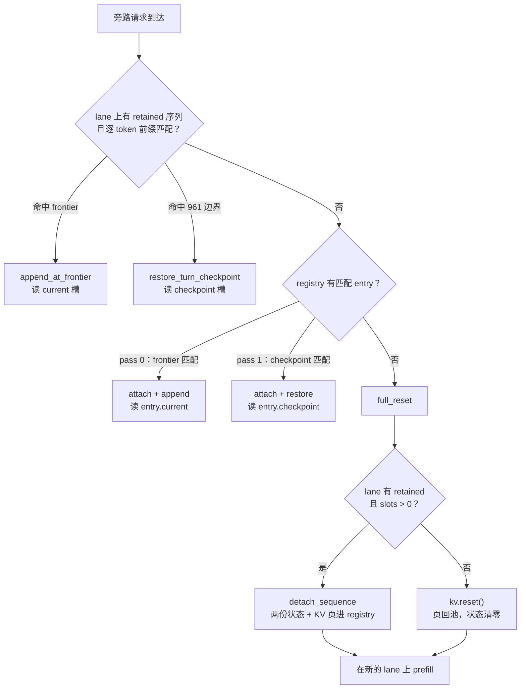

# 旁路请求打掉会话前缀缓存：决策、现状与证据

> **状态：现行 · 本主题的唯一权威**
> 记录：2026-10-24 · 角色：note · 归属：active
> 适用条件：Windows 11 · 2×Tesla V100-SXM2-16GB · `sm_70` · CUDA 12.8 · TP2 · `qwen3.8-27b` · `--max-concurrency 1`
> 取代：`kv-cache-title-request.md`（问题分析与方案枚举）、`kv-cache-title-request-p0.md`（首轮实测），两份均已归档
> 结论一句话：C=1 下用 **detached prefix registry**（方案 3）保住会话，已实现并合入 `master`（`f7a284a`）。

图示说明：正文用 ASCII 与 mermaid 而不是位图——固定配色的图片在白/暗两种主题下总有一半不可读，
且无法 diff。需要精确像素图时按 §9 的复现命令重跑探针。

---

## 0. 一句话

`--max-concurrency 1` 时只有一个 lane，旁路请求（改标题、摘要）必须落上去，把会话的 retained
序列连同它的支点一起销毁，下一轮 `cached` 归零。已实现的做法是：**让会话与 lane 解绑**——
状态与 KV 页留在 registry 里，之后任意 lane 可重新 attach。

---

## 1. 问题

### 1.1 现象

一轮对话开始时，客户端并发发一个「改会话标题」请求（42 token 的模板 prompt）。该会话下一轮
的 `cached` 从 961 变成 0，路径从 `restore_turn_checkpoint` 变成 `full_reset`。
损失约等于一次全量 prefill：32k 会话约 27 s（@1110 tok/s），实测 1k 会话 2.07 s → 1.53 s。

### 1.2 机制：两个独立的销毁点

| # | 销毁点 | 触发条件 | 后果 |
|---|---|---|---|
| ① | `sequence.kv.reset()` | 请求走 `FullReset`（prompt 在 token 0 就分叉） | KV 页当场回池 |
| ② | `rewrite_checkpoint` 被 `CaptureNew` 覆盖 | 任何请求产生新边界 | 支点被换成别的会话的 |

**关键区分：页存活 ≠ 支点存活。** 只修一个都不成立，这是最初判断错误的来源。

### 1.3 为什么「提高并发」单独无效

C=2、两个 lane 都空闲时，旁路请求在两个 lane 上的 `reusable_prompt_tokens` 都是 0
（lane 0 上它与 retained 会话首 token 不同；lane 1 上它没有 retained）。准入第一趟用
`reuse > selected_reuse` 严格比较，相等时不换人，lane 从 0 递增 ⇒ **永远选 lane 0**，
也就是会话所在的 lane。杀死缓存的是「下标最小」这个 tie-break，不是 lane 数不够。

---

## 2. 判据：一次观测就能分辨修复路线

分歧点只有一个：**旁路请求进入规划阶段时，页是否还活着**。字段现成
（`GenerationResult.prefix_reuse_path`）。实测（C=1，`registry=0`）：

| 组 | 请求 | prompt | `cached` | path | 页还在？ |
|---|---|---:|---:|---|---|
| C 对照 | turn2 | 1030 | **961** | `restore_turn_checkpoint` | 是 |
| A 典型标题 | title(42) | 42 | 0 | `full_reset` | **否** |
| | turn2 | 1025 | **0** | `full_reset` | 否 |
| B postfix 标题 | title | 1033 | **962** | `restore_turn_checkpoint` | 是 |
| | turn2 | 1031 | **0** | `full_reset` | 页在，支点没了 |

四条读数：

1. 正常多轮靠 **`restore_turn_checkpoint`**，不是 `append_at_frontier` ⇒ 清 checkpoint 就是主销毁路径。
2. A 组标题请求自己是 `full_reset` ⇒ `reset()` 在入口已执行，页当场回池。
3. B 组：页活着（标题自己命中 962），但紧接着短 2 token 的 prompt 仍 `full_reset` ⇒ 两个销毁点互相独立。
4. 同一组实验搬到 C=2，A/B 组 turn2 仍是 0 ⇒ lane 数不是变量。



---

## 3. 选了什么，为什么

| 方案 | 是否存在 | 否决/采纳理由 |
|---|---|---|
| 1 postfix（应用层） | 否 | 标题 prompt 由客户端构造，典型形状 token 0 就是指令模板，改不了 |
| 2 `PreserveExisting`（~30 行） | 否 | 只在「页未释放 + postfix 形状」成立；典型形状入口即 `full_reset`，页已回池 |
| **3 detached registry** | **✅ 采纳** | 唯一不依赖客户端、且 C=1 下有效的方案 |
| 4 lane 选择键（~10–50 行） | 否 | 仅 C≥2；C=1 只有一个 lane，没有第二候选 |
| 0 截断式标题（绕开） | 备选 | 不改进引擎，但要求客户端配合；与方案 3 不冲突 |

方案 3 的代价是三条不变量要重新证明：detach 后状态槽不被 lane 复用、页不被二次释放、
attach 时 frontier 与状态一致。这也是它被放到最后才做的原因。

---

## 4. 现状（已实现，`master` `f7a284a`）

| 提交 | 内容 |
|---|---|
| `0eca192b` | 主体：detach / attach、registry 槽位、准入记账、容量治理 |
| `58dedde4` | 修 `start_prefill` 过早清 `retained`；displacement 改 best-effort |
| `f87e7915` | 修准入与回收不一致（hang 的真因）；attach 抢占不再牺牲别的会话 |
| `88730c28` | 准入收敛为一个 `plan_lane_admission` + 一个执行器，删除第二本账 |
| `f7a284a` | `--prefix-registry-drop-current`；日志加 `attach_registry_entry` / `registry_keep_current` |
| `abc3fb64` `e1f07998` `d66b3e1f` | 容量规则按 C=1 / C≥2 分开写，并撤回一条错结论 |
| `ba9537de` | hang 写成单一问题陈述（成因链与证据缺口） |

### 4.1 槽位布局

```text
lane 槽      [ 0 .. C )          lane i 的 current（frontier 状态，每步读改写）
             [ C .. 2C )         lane i 的 rewrite checkpoint（turn 边界快照）

registry（默认，keep-current）
             [ 2C .. 2C+2R )     entry e: current = 2C+2e
                                          checkpoint = 2C+2e+1

registry（--prefix-registry-drop-current）
             [ 2C .. 2C+R )      entry e: checkpoint = 2C+e
                                  registry_state_slot() 在此模式下抛异常，不返回别的 entry 的槽
```

两段区间不重叠，这是「一条 lane 被无关请求占用时 entry 状态不被踩」的全部依据。

### 4.2 两份状态不是主备

| | current | rewrite_checkpoint |
|---|---|---|
| 内容 | frontier（最后算过的 token）处的状态 | turn 边界处的状态 |
| 写入 | 每个 prefill/decode step 读改写 | 越过边界时 `copy_slot(checkpoint ← current)` 一次 |
| 读者 | `append_at_frontier` | 所有 restore 路径、MTP 提案 |
| 能否事后重建 | 可以：从 checkpoint 重放 Δ 个 token（单向推进） | **不可以**：状态不可回滚，晚了就没了 |

所以两者不是冗余：**晚的那个可以事后算出来，早的那个必须在经过它时当场落盘**。

### 4.3 ABAB 四步（C=1、R=1、keep-current）

```text
                ①A.turn1        ②B 落地         ③A.turn2        ④B 再来
lane.current    A@frontier      B@frontier      A@frontier2     A@frontier2
lane.checkpoint A@961           B@boundary      A@961           A@boundary2
entry.current   —               A@frontier      —               —
entry.checkpoint—               A@961           —               —
                                     ↑ detach        ↑ attach
结果            —               B 完成          cached 961      cached 0
                                                 (restore)      (无 entry 可接)
```

③ 时 B 被挤下且**无处可去**（registry 满、正在消费的 entry 属于 A）⇒ 直接丢弃。这不是缺陷，
是 R=1 的定义：接回目标会话优先于保留一个可牺牲的旁路请求。

---

## 5. 实测数据

所有数字的原始文件在 `_scratch/append_probe/`（不进 git），采集环境见 §9。

### 5.1 端到端（32768 ctx，会话 965 token，`--prefix-registry-slots 1`）

| 组 | 旧二进制 | flag 关 | `registry=1` |
|---|---:|---:|---:|
| 对照 turn2 `cached` | 961 | 961 | 961 |
| 典型标题后 turn2 `cached` | 0 | 0 | **961**（`restore_turn_checkpoint`） |
| postfix 标题后 turn2 | 0 | 0 | 0（该形状无 detach，不在本方案职责内） |

### 5.2 容量：槽数 = 容器数 × 2，不是会话数

| 配置 | 总槽数 | 显存/卡 | 会话 turn2 | 侧请求重发 |
|---|---:|---:|---:|---:|
| `registry=0` | 2 | 147 MiB | 0 | 0 |
| `registry=1` | 4 | 294 MiB | **961** | 0 |
| `registry=2` | 6 | 440 MiB | 957 | 0 |
| `registry=3` | 8 | 587 MiB | 957 | **311** |
| `registry=4` | 10 | 734 MiB | 957 | **311** |

**保会话只要 1 个 entry**；侧请求自己也要复用则需要 3 个（第 4 跳还要一个空容器接住被换下
的序列）。`registry=2` 相对 1 只多花 147 MiB，对两个指标都没有改善。

### 5.3 复用路径可达性（决定 current 槽能不能删）

| 组 | 形状 | prompt | cached | computed | path | attach |
|---|---|---:|---:|---:|---|---|
| D1 | `A1 → [u1,a1]`（assistant 结尾） | 1044 | 1035 | 9 | append | false |
| **D2** | `A1 → B → [u1,a1]` | 1041 | **1032** | **9** | **append** | **true** |
| **D2'** | 同上换文本 | 1046 | **1037** | **9** | **append** | **true** |
| T1 | `A1 → B → A2`（user 结尾） | 1055 | 980 | 75 | restore | true |
| T5 | `A1 → A1+a1+继续` | 1043 | 979 | 64 | restore | false |

聚合（41 条 `request_done`）：

```text
 2  attach=true   append_frontier
 5  attach=true   restore_turn_checkpoint
 3  attach=false  append_frontier
 8  attach=false  restore_turn_checkpoint
23  attach=false  full_reset
```

结论：attach 之后走 append 是**可达**的，触发条件是 **prompt 以 assistant 消息结尾**
（续写、assistant 预填）。同一份 a1 后面再跟一条 user 消息时，`[981,1032)` 区间的模板编码
不同，逐 token 校验失败，只能退回 checkpoint 边界。

### 5.4 `--prefix-registry-drop-current`（entry 只存 checkpoint）

| 项 | 数值 |
|---|---|
| `runtime_reservation_bytes` | 1,920,778,496 → 1,843,806,464（**−76,972,032 B = 73.41 MiB/卡/entry**） |
| `sequence.capacity_bytes` | 1,467,057,408 → 1,390,085,376（同差值） |

| 组 | 形状 | keep | drop |
|---|---|---|---|
| G1 | `A1→B→A2`（user 尾） | 979 / 75 / restore | **完全相同** |
| G2 | `A1→B→[u1,a1]`（assistant 尾） | **1035 / 9 / append**，TTFT 0.062 s | **979 / 65 / restore**，TTFT 0.322 s |
| G3 | 同 G2 换文本 | 1030 / 9 / append | 979 / 60 / restore |
| G4 | `A1→[u1,a1]`（无旁路） | 1035 / 9 / append | **完全相同**（lane 自有 append 不受影响） |

- 降级成本 = checkpoint 边界到 frontier 的间隔（51–56 token ≈ 260–283 ms），随上一轮回复长度线性增长。
- 两配置生成文本 **sha256 相同**（53 token）⇒ 恢复出来的状态是对的，不是「能跑」而已。
- drop 模式下 `attach && append_frontier` 计数 **0**，由 pass 0 整趟跳过保证。

### 5.5 MTP（`--spec mtp --draft-tokens 3`）

| 组 | keep | drop |
|---|---|---|
| G1 | 979 / 80 / restore | 相同 |
| G2 | **1030 / 9 / append**，TTFT 0.074 s | **979 / 60 / restore**，TTFT 0.342 s |
| G3 | 1030 / 9 / append | 979 / 60 / restore |
| G4 | 1030 / 9 / append | 相同 |
| 预留 | 2,069,444,864 | 1,992,472,832（差同为 73.41 MiB） |
| 投机统计 | 414 drafted / 278 accepted / accept **0.6715** | **完全相同** |

没掉到 `full_reset`：detach 时 `mtp_kv_valid = 1039 ≥ checkpoint 979 − 1`，`checkpoint_ready`
成立。这条边界仍然存在，只是本形状踩不到（需 entry 由未 prepare_mtp 的请求 detach 才可能）。

### 5.6 分支行为测试（`ninfer_qwen3_8_27b_v100-duo_prefix_real_test`，6m33s，exit 0）

```text
V100 Duo prefix reuse: graph/eager outputs, logits, acceptance and frontiers PASS
cold_teacher_force_mismatches graph=0 eager=0
partial_terminal_append        prompt=3320 reused=3290 computed=30    ← append 路径
registry_turn2                 prompt=3335 reused=3305 computed=30    ← restore 路径
registry_turn2_cold            prompt=3335 reused=0    computed=3335
detached prefix registry: displaced session restored 3305/3335 tokens
V100 Duo detached prefix registry: PASS
```

两条复用路径都在这一轮里被覆盖。

### 5.7 速率零回归（`slots=0` vs `slots=1`，同窗口）

| 测点 | slots=0 | slots=1 |
|---|---:|---:|
| prefill 4k | 1121.1 | 1120.6 |
| prefill 8k | 1105.6 | 1105.1 |
| prefill 32k | 1029.2 | 1031.1 |
| decode 512 | 149.3 | 149.5 |
| decode 8k | 141.7 | 141.8 |

全部 ≤0.5%。

### 5.8 状态槽成本（为什么一个槽 73.4 MiB）

```text
recurrent（FP32，{key_head_dim 128, value_head_dim 128, value_heads 24, slot}）
  = 48 层 × 24 head × 128 × 128 × 4 B = 75,497,472 B ≈ 72.0 MiB
conv（BF16，{conv_channels 5120, conv_width 3, slot}）
  = 48 层 × 5120 × 3 × 2 B = 1,474,560 B ≈ 1.4 MiB
合计 ≈ 73.4 MiB / 槽 / 卡
```

- 与上下文长度无关：这是 GDN 的常数代价，交叉点约 **4.3k token**（73.4 MiB ÷ 17 KiB/token）。
- KV per token per card = 16 层 × 2(K,V) × 2 head × 256 B + scale ≈ **17 KiB**；
  32k → 544 MiB，256k → 4.25 GiB。
- 所以 965 token 的短会话里，状态槽是最贵的固定项（KV 只有 16 MiB）；
  256k 长上下文里它只占 KV 的 1.7%，基本免费。

---

## 6. 被撤回的结论

| 旧结论 | 状态 | 修正 |
|---|---|---|
| 「提高 `--max-concurrency` 能缓解」 | 部分撤回 | 单独提无效（严格大于 + 下标优先）；它是方案 4 的前提，不是方案本身 |
| 「`N ≥ k+1` 是通用容量规则」 | 撤回 | 只在 C≥2 成立；C=1 单会话 1 槽就够，多配 2 槽白花 147 MiB |
| 「第二个 slot 买不到东西」 | 已撤回 `d66b3e1f` | 把「被丢弃」与「不可用」混为一谈；侧请求需要 3 槽（§5.2） |
| 「registry entry 的 current 槽是死重，可删」 | **已撤回** | 可达性实测为真（§5.3，2/2）；删掉会静默算错，不是变慢 |
| 「entry 的 current 可替换为 checkpoint」 | 撤回 | 反向不可重建（§4.2）：current→checkpoint 是回退，只能整段重来 |

最后两条合起来的教训：**选择顺序（append 优先）只能证明「可用就会赢」，不能证明「不可用」**。
判断可达性必须拿真实 token 流——样本里缺一种形状（assistant 结尾）就会得出反向结论。

---

## 7. 已知边界

- **KV 池是上限**：装不下时 entry 一定被淘汰，收益上限就是「池子装得下」的那部分。
- **detached 期间 KV 页一直占着**（32k 会话 = 32765 token 的页），不还给池子。这是方案 3 的
  真实显存成本，比 73.4 MiB 状态槽大一个量级。
- **`--no-prefix-reuse` 与 `--prefix-registry-slots` 互斥**，启动即拒绝。
- **drop-current 只测了 MTP**；DFlash 在 TP2 不支持，本 fork 无法覆盖。
- **greedy 不等于跨后端可复现**：`temperature 0` 下 `spec=mtp` 与 `spec=none` 输出不同
  （87 vs 92 字符，个别词不同），各自内部可复现。未判定是数值末位差还是接受逻辑问题。
- **registry 选 entry 的两趟扫描有优先级**：append 候选整体优先于 checkpoint 候选，
  同类内取最长前缀。这决定了「有 append 候选时 restore 候选不会被看见」。

---

## 8. 还没做的

1. **KV 压力场景只有脚本没有用例**（`_scratch/bench/kv_pressure.py`），是防 hang 回归的唯一证据；
   建议落点 `tests/targets/qwen3_6_27b/test_engine_v100-duo_kv_pressure.cpp`。
2. **C=2 没有端到端并发验证**，只跑过串行 cohort。
3. **准入被拒（`QueueTimeout`）边界未实测**（`--pending-timeout-ms 100` 即可构造）。
4. **`admit_planned_request` 的 throw 仍走 `fail_all`**：触发窗口变窄，不是不会发生。
5. **bench 口径失效**：`--no-prefix-reuse` 被互斥规则禁用后，隔离缓存要改成「每次不同 nonce」。
6. **drop-current 的生产默认值未定**：取决于真实流量里「assistant 结尾 + registry 命中」的比例，
   需要现网日志统计，不是构造用例能回答的。

---

## 9. 复现

```bash
# 起服务（C=1，1 个 registry entry）
./build-win/apps/ninfer-serve.exe F:/models/ninfer/qwen3_8_27b_nvfp4.ninfer \
  --host 127.0.0.1 --port 18888 --max-context 32768 --kv-capacity 32768 \
  --tp 2 --devices 0,1 --max-concurrency 1 --prefix-registry-slots 1 \
  --request-log-jsonl _scratch/append_probe/requests.jsonl

# 只存 checkpoint（省 73.41 MiB/卡/entry）
#   追加 --prefix-registry-drop-current
# MTP 变体
#   追加 --spec mtp --draft-tokens 3

# 对比脚本（四组 G1–G4，两配置逐字节相同 messages）
python _scratch/append_probe/compare_drop_current.py keep|drop|compare

# 行为测试（约 6.5 分钟，三次加载）
export NINFER_V100_DUO_ARTIFACT=F:/models/ninfer/qwen3_8_27b_nvfp4.ninfer
./build-win/tests/ninfer_qwen3_8_27b_v100-duo_prefix_real_test.exe
```

测量卫生（沿用旧笔记，仍然有效）：

- `/metrics` 约 1 s 发布一次，0.42 s 的短请求会落进下一个窗口 ⇒ 以响应体 `usage.cached_tokens`
  为准，累计差值只作交叉验证，每请求后 settle 1.3 s。
- 本机 shell 有 `http_proxy` ⇒ 本地请求必须 `curl --noproxy '*'` 或 `no_proxy=127.0.0.1,localhost`。
- 不要按索引对齐并发日志，用 `result.prompt_tokens` 匹配。
- 不要在 KV 边缘做压力实验（会挂驱动，需重启机器）。

---

## 10. 证据索引

| 主张 | 证据位置 |
|---|---|
| 旁路请求打掉 turn2 缓存 | §5.1、旧笔记 p0 四 cohort 原始表 |
| 两个销毁点独立 | §2 第 3 条（B 组：标题命中 962，turn2 仍 0） |
| 提并发单独无效 | §1.3（代码）+ C=2 下 A/B 组仍为 0（实测） |
| 保会话只需 1 entry | §5.2 |
| append+attach 可达 | §5.3 聚合表，2/2 |
| drop-current 省 73.41 MiB | §5.4 启动日志 `memory` 块逐字段 |
| drop-current 输出等价 | §5.4 sha256 |
| MTP 无额外损失 | §5.5 accept rate 完全一致 |
| 两条复用路径都被测试覆盖 | §5.6 |
| 速率零回归 | §5.7 |
| 状态槽 73.4 MiB 的算式 | §5.8 |
